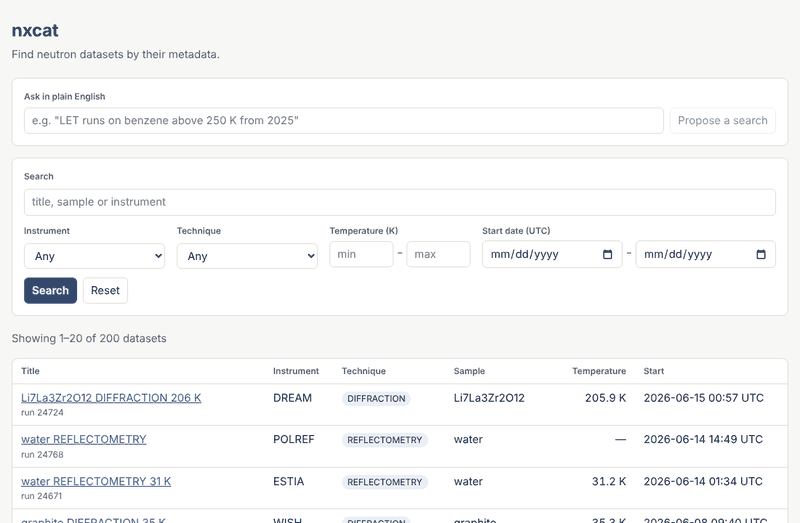
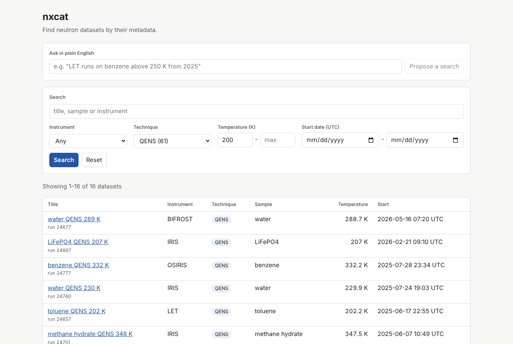
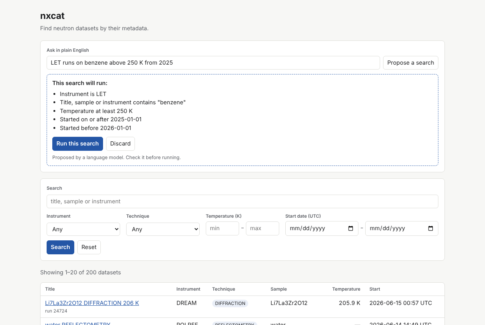
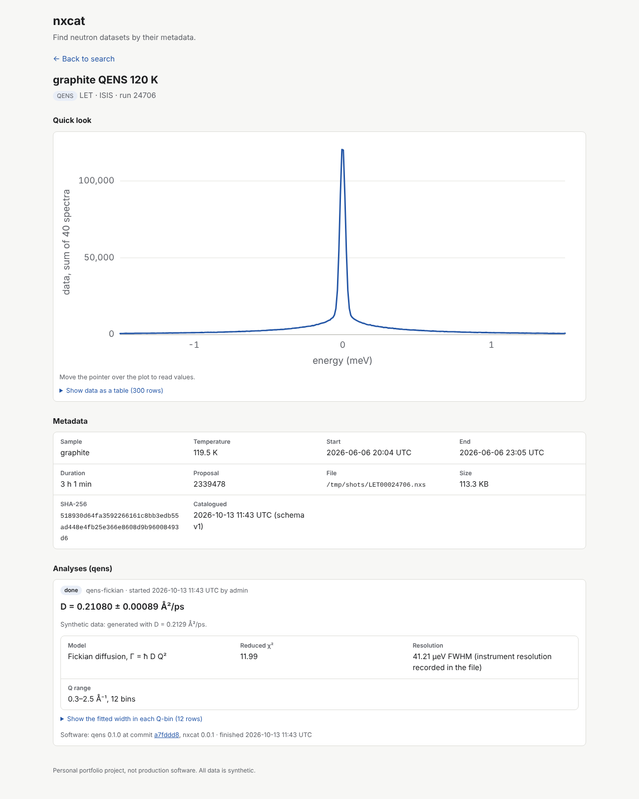
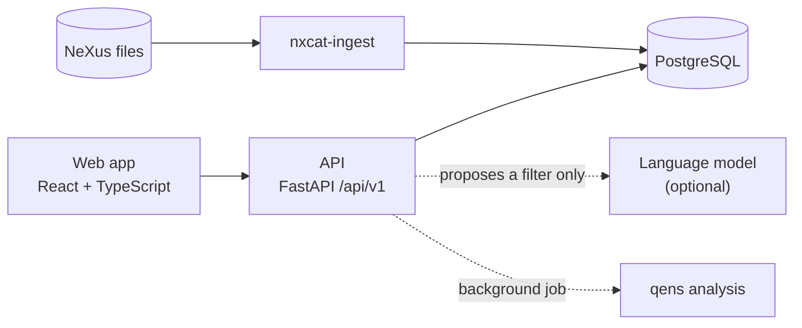

# nxcat


A small, open-source metadata catalogue for neutron (NeXus/HDF5) data.

> **Personal portfolio project, not production software.** Latest release: [v0.1.0](CHANGELOG.md).



## Problem

A neutron facility produces thousands of data files, and scientists need to find them
by what was measured (instrument, sample, temperature, date) rather than by folder and
file name. nxcat reads the metadata inside NeXus/HDF5 files, checks it, and makes it
searchable through an API and a web app. It is a small model of the kind of data
catalogue a facility runs, built to learn and show the engineering involved.

## Features

- [x] Ingest NeXus/HDF5 files with metadata validation (bad files are logged and skipped)
- [x] REST API with search, filters, paging and facets (FastAPI, OpenAPI docs)
- [x] Web app (React + TypeScript): search with filters and paging (filters kept in the address, so searches can be shared); dataset page with full metadata and a quick-look plot
- [x] Plain-English search: the language model only proposes a validated filter, and the user confirms it before it runs (see below)
- [x] Tests and CI: pytest against a real PostgreSQL, Vitest, ruff, mypy (strict) and oxlint on every pull request, plus an end-to-end check of the whole Docker stack. Backend coverage (lines and branches) was 98.5% on 13 October 2026; CI fails below 80%
- [x] Integration: run a [qens](https://github.com/ShubhamX57/qens) analysis on a QENS dataset and store the result with provenance ([why qens](docs/adr/0002-integration-qens-analysis-job.md))

## Screenshots

All data shown is synthetic (see [data/SOURCES.md](data/SOURCES.md)).

| Search with filters | Plain-English search: proposal before it runs |
|---|---|
|  |  |

The model replies in these images and the demo are the real replies qwen2.5:7b-instruct gave
during the evaluation run, replayed from its cache.



## Architecture



Details, request flows and the reasons behind them: [docs/architecture.md](docs/architecture.md).
Design decisions: [docs/adr/](docs/adr/README.md).

## Quick start

Requirements: Docker. One command starts PostgreSQL, the API and the web app:

```bash
docker compose up -d --build --wait

# Load 200 synthetic datasets (plus 5 deliberately broken files)
docker compose exec api nxcat-generate --out /data/generated -n 200 --with-broken
docker compose exec api nxcat-ingest /data/generated
```

Then open the app at <http://localhost:8080>, and the API docs at <http://localhost:8000/api/v1/docs>.
Stop with `docker compose down` (add `-v` to delete the data too).

## Plain-English search

Type a question such as *"LET runs on benzene above 250 K from 2025"*. A language model
proposes a filter, nxcat validates it and shows it in plain words, and the search runs
only when you press **Run this search**. The model never answers questions about the
data and never runs anything itself
([design decision](docs/adr/0001-llm-only-proposes-a-validated-filter.md)).

It is optional and off by default. To use a free local model with [Ollama](https://ollama.com):

```bash
ollama pull qwen2.5:7b-instruct
sed -i '' "s|^NXCAT_LLM_MODEL=.*|NXCAT_LLM_MODEL=ollama/qwen2.5:7b-instruct|" .env
docker compose up -d --wait
```

Any model that [LiteLLM](https://docs.litellm.ai) supports can be used instead.

## AI evaluation

Plain-English search is measured on 30 fixed questions (`backend/tests/ai_eval/questions.json`):
20 normal, 5 ambiguous and 5 out of scope. To run it against a model:

```bash
cd backend
uv run nxcat-eval --model ollama/qwen2.5:7b-instruct --api-base http://localhost:11434
```

This writes `docs/ai-evaluation.md` and caches every reply, so the run can be repeated
with `--replay-only`.

**Results** (qwen2.5:7b-instruct via Ollama, run 13 October 2026): 16/20 exact filters, 5/5 out-of-scope questions rejected, 0 invalid filters executed; 3/5 ambiguous questions led to a request to clarify. Full table: [docs/ai-evaluation.md](docs/ai-evaluation.md).

## qens analysis

For QENS datasets, nxcat can run [qens](https://github.com/ShubhamX57/qens) to measure
the self-diffusion coefficient **D**: qens reads the S(2θ, ω) data, fits the
quasi-elastic width Γ in each Q-bin, and nxcat fits Fickian diffusion,
Γ = ħ D Q², to those widths. Each run is stored with its settings, the exact qens
commit, who started it and when, and appears on the dataset page.

Starting a run is a write action (log in first, see below):

```bash
TOKEN=$(curl -s -d "username=admin&password=YOUR PASSWORD" localhost:8000/api/v1/auth/token | python3 -c "import json,sys;print(json.load(sys.stdin)['access_token'])")
curl -s -X POST -H "Authorization: Bearer $TOKEN" -H "Content-Type: application/json" -d '{}' localhost:8000/api/v1/datasets/ID/analyses
```

or use **Authorize** and `POST /api/v1/datasets/{id}/analyses` in the API docs.
The run happens in the background; the dataset page updates when it finishes.

**Accuracy on synthetic data** (where the true D is known): within about 1–2% when
the instrument resolution is recorded in the file. Without it, the resolution has to
be estimated from the data's own elastic peak, and D comes out about 15% too high;
the result then carries a warning saying so.

## Write actions (admin login)

Reading is open. Changing the catalogue, for now starting an ingest, needs a login
token. Without login settings nxcat is read-only, and write requests answer 503.

```bash
cp .env.example .env
KEY=$(python3 -c "import secrets; print(secrets.token_urlsafe(48))")
sed -i '' "s|^NXCAT_SECRET_KEY=.*|NXCAT_SECRET_KEY=$KEY|" .env
HASH=$(cd backend && uv run nxcat-hash-password)   # asks for a password (12+ characters)
sed -i '' "s|^NXCAT_ADMIN_PASSWORD_HASH=.*|NXCAT_ADMIN_PASSWORD_HASH='$HASH'|" .env
docker compose up -d --wait                         # restart so the API reads .env
```

These write the secrets straight into `.env` without showing them (on Linux, use
`sed -i` instead of `sed -i ''`). The hash must stay in single quotes, because it
contains `$` signs that Docker Compose would otherwise treat as variables.

Then, in the API docs at <http://localhost:8000/api/v1/docs>, press **Authorize**,
log in, and call `POST /api/v1/ingest` with `{"folder": "generated"}`. Only folders
inside the data root (`/data` in Docker) can be ingested.

## Development

Requirements: Python 3.12, [uv](https://docs.astral.sh/uv/), Docker.

```bash
docker compose up -d db          # PostgreSQL on localhost:5432 (dev credentials)
cd backend
uv sync
uv run pytest                    # database tests are skipped if the db is not running

# Try it with synthetic data
uv run nxcat-generate --out ../data/generated -n 200 --with-broken
uv run nxcat-ingest ../data/generated

# Run the API, then open http://localhost:8000/api/v1/docs
uv run uvicorn nxcat.api.app:app --reload
```

Web app (needs Node 22.12 or newer, and the API running on port 8000):

```bash
cd frontend
npm install
npm run dev                      # http://localhost:5173
npm test                         # Vitest + React Testing Library
```

Run `pre-commit install` once, from the repository root.

## Limitations

nxcat is a personal portfolio project, not production software. In particular:

- **Synthetic data.** It is tested on generated files and has not been run against a
  facility's real archive. Real NeXus files vary more than the generator does.
- **One admin user.** Login is a single account set in `.env`, with short-lived tokens
  and no way to revoke one early. There are no user accounts, groups or embargo rules,
  which a real catalogue needs.
- **No migrations.** Tables are created at start-up. A schema change on a database
  that already holds data would need a migration tool such as Alembic.
- **Simple background jobs.** Analyses run inside the API process. If the API restarts
  during a run, the run is marked as failed at start-up and has to be started again.
  This only works with a single API process; a real service would use a job queue.
- **Search.** PostgreSQL full-text search with English stemming: no typo tolerance and
  no relevance tuning ([why](docs/adr/0003-postgresql-full-text-search.md)).
- **Plain-English search** depends on the model. With qwen2.5:7b it got 16 of 20 normal
  questions exactly right; the other answers are visible to the user before anything
  runs, but they are still wrong.
- **qens analysis** fits only a simple Fickian model, and its error bar on D counts
  only counting noise, so it is too small (the reduced χ² is well above 1).
- **Quick-look plot** sums 2-D data over detectors. It is a preview, not an analysis.

## Contributing

See [CONTRIBUTING.md](CONTRIBUTING.md).

## Licence

MIT. See [LICENSE](LICENSE).
