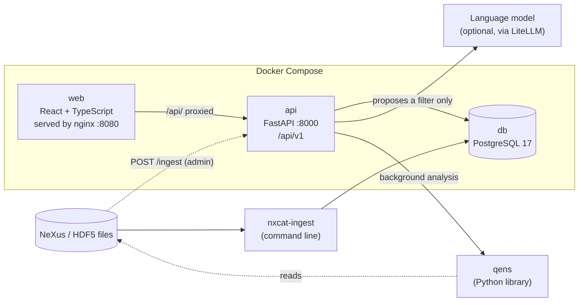

# Architecture

nxcat is three small services and a command-line tool. This page explains what each
part does, how a request flows through them, and why they are split this way.

## The parts

| Part | Code | Job |
|---|---|---|
| Ingest | `backend/src/nxcat/ingest/` | Finds NeXus files, reads the metadata with h5py, validates it with pydantic (`models/metadata.py`) and upserts one row per file. Bad files are logged and skipped ([ADR 0004](adr/0004-ingest-skips-bad-files-and-is-idempotent.md)). |
| Database | `models/tables.py`, `db.py` | Three tables: `dataset`, `ingest_error`, `analysis`. A generated `tsvector` column with a GIN index gives full-text search ([ADR 0003](adr/0003-postgresql-full-text-search.md)). |
| API | `api/` | FastAPI under `/api/v1`, with OpenAPI docs. Reading is open; write actions (ingest, analyses) need an admin token. |
| Plain-English search | `ai/` | The model may only propose a `FilterSpec`, which is validated and shown to the user before it runs ([ADR 0001](adr/0001-llm-only-proposes-a-validated-filter.md)). |
| Analysis | `integrations/qens_job.py`, `api/analyses.py` | Runs a qens diffusion fit on a QENS dataset in the background and stores the result with its settings and software versions ([ADR 0002](adr/0002-integration-qens-analysis-job.md)). |
| Web app | `frontend/src/` | Search page (filters kept in the URL), dataset page with a quick-look plot, the confirm-before-run panel and the analyses section. |

## How a search works

1. The user changes a filter on the search page. The filters are written to the URL,
   so a search can be bookmarked or shared.
2. The web app calls `GET /api/v1/datasets?instrument=LET&temp_min=250&...`.
3. FastAPI validates the query string against `SearchQuery` (pydantic). Wrong types,
   unknown values or a minimum above a maximum give a 422 with a clear message.
4. `api/search.py` turns each filter into one SQL condition. Every value is a bound
   parameter, so user input is never pasted into SQL.
5. PostgreSQL returns one page of rows and the total count, which the API returns as JSON.

## How a plain-English search works

1. The user types a question. The web app sends it to `POST /api/v1/search/ask`.
2. The API asks the model for one JSON object: a filter, `out_of_scope` or `unclear`.
3. The reply is checked by `FilterSpec` and then by the normal `SearchFilters`. If either
   check fails, the user sees "could not understand" instead of a guess.
4. nxcat (not the model) describes the filter in plain words. The user presses **Run**,
   and only then does the normal search endpoint run.

## How an analysis works

1. An admin calls `POST /api/v1/datasets/{id}/analyses`. The API checks the dataset
   is QENS and the file exists, stores a `queued` row and answers **202 Accepted**.
2. A FastAPI background task runs the qens fit and stores `done` with the result,
   or `failed` with a readable reason. It never crashes the API.
3. The dataset page polls every 2 seconds while a run is queued or running.
4. If the API restarts during a run, the background task is lost. At start-up the API
   marks any analysis still `queued` or `running` as failed, with a reason, so the page
   never waits for ever.

## Why it is built this way

- **One database for everything.** PostgreSQL holds the catalogue, the search index
  and the analysis results, so there is only one service to run and back up.
- **Validation at every boundary.** File metadata, query strings, model output and
  analysis settings all pass through pydantic models before they are used.
- **The front end is a separate app.** It talks to the API only through the same
  public `/api/v1` that any other client would use, so the API is tested and documented
  as a real interface.
- **Everything runs in Docker Compose.** `docker compose up` gives the same stack on
  any machine, and CI starts that same stack and checks it end to end.

## Testing and CI

| Layer | Tools | What is checked |
|---|---|---|
| Backend | pytest, a real PostgreSQL, ruff, mypy (strict) | Ingest of valid and broken files, every API endpoint, FilterSpec validation, the qens job, password and token handling |
| Front end | Vitest, React Testing Library, oxlint, tsc | Search page, filters in the URL, dataset page, confirm-before-run, analyses section |
| Whole stack | GitHub Actions `docker` job | Builds the images, ingests synthetic data, calls the API through nginx, runs one real qens analysis, and checks that writes and AI search are off by default |

See the [Limitations](../README.md#limitations) in the README for what this design does not cover.
